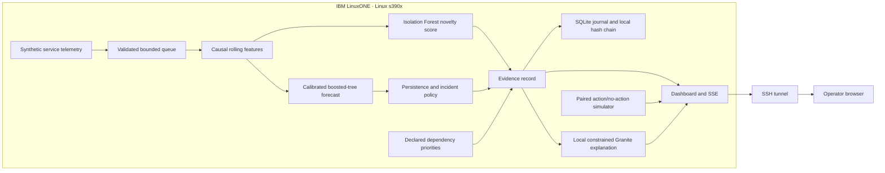

# ContinuityGuard

**RASCALS · IBM Z Datathon 2026 · Real-Time AI for Critical Decisions**

Early warning for failures in hospital digital-service infrastructure. ContinuityGuard combines a learned 60-second service-breach forecast, multivariate novelty scoring, a declared dependency map, evidence-linked runbooks, and a controlled action/no-action simulator. Training and testing run in Jupyter on IBM LinuxONE Community Cloud.

Submission artifacts: [pitch PDF](submission/RASCALS-ContinuityGuard-Pitch.pdf), [2:39 narrated evidence walkthrough](submission/RASCALS-ContinuityGuard-Walkthrough.mp4), [form answers](submission/FORM-ANSWERS.md), and [final handoff checklist](submission/FINAL-CHECKLIST.md). The video uses labeled synthetic narration and actual saved evidence; it is not continuous live capture. A YouTube/Vimeo upload and manual portal entry remain team actions.

**Scope:** a working research prototype using synthetic one-second service telemetry. It is not validated on hospital production systems and does not make clinical decisions. The runtime can accept validated external events, but the submitted benchmark and demo use the included simulator. No real hospital outage was prevented or patient outcome measured.

## What is implemented

- A bounded streaming pipeline with per-service causal feature windows and shared training/inference code.
- A 60-second forecast: three candidate models, sigmoid calibration on separate runs, and joint model/policy selection on validation runs.
- Isolation Forest novelty scores, displayed separately from forecast risk. The selected v2 alert policy uses the forecast; novelty does not trigger its pages because it increased alert noise in validation.
- Persistence, deduplication, rejection of out-of-order events, explicit stale input and a threshold fallback when model inference fails.
- Service-impact ordering using declared software-service priorities. Suspected source is a heuristic, not proof of causality.
- Runbook response previews using the same synthetic demand/noise in action/no-action branches. No commands execute against real services.
- Local IBM Granite explanation under a strict evidence schema; invalid generation falls back to a labeled deterministic summary.
- Authenticated dashboard, SSE updates, a bounded ingestion queue, persistent SQLite journal and a verifiable local hash chain.
- A native s390x container configuration with a non-root process, resource limits, read-only root filesystem, dropped capabilities and SSH-tunnel access.

## Results produced on LinuxONE

Final evaluation uses **60 independent synthetic test runs**, **47 service incidents**, and **10 healthy service-hours**. Whole-run train, calibration, validation and final test seeds are disjoint. Four services in one run share a dependency, so the 47 service incidents are not 47 independent physical failures.

| Detector | Early-warning recall | Incident precision | Median lead among early warnings | Missed incidents |
|---|---:|---:|---:|---:|
| Static thresholds | 89.4% | 68.3% | 9 s | 4 / 47 |
| Robust statistics | 63.8% | 20.3% | 36.5 s | 17 / 47 |
| Isolation Forest | 85.1% | 26.7% | 46 s | 7 / 47 |
| **ContinuityGuard** | **91.5%** | **61.4%** | **37 s** | **4 / 47** |

ContinuityGuard and the threshold baseline each detected 43 of 47 incidents; one threshold detection was late. Neither alerted during the tested 10 healthy service-hours. ContinuityGuard generated **27 unmatched alerts across all test runs**, versus 20 for thresholds. Zero observed healthy-run alerts does not establish a zero production false-alarm rate.

The chosen forecast is **HistGradientBoostingClassifier, 7 leaves**, plus sigmoid calibration. Final forecast PR-AUC is **0.850** at a positive prevalence of **5.02%**; Brier score **0.01665**. These values are conditional on the simulator distribution. The unseen abrupt-failure stress set had **24/24 detected incidents and 0 early warnings**: no warning is invented when there is no precursor.

The paced direct-engine benchmark accepted **100 synthetic service-window events/s** over eight seconds, with **9.03–53.60 ms p95 across two runs processing per four-event batch**, no rejections, and about **186 MB process RSS**. It includes features, inference, incident policy and SQLite commits. It excludes HTTP ingestion, queue waiting and browser rendering, and runs with generation off. It is not a maximum-capacity or production-scale claim.


Full evidence: [evaluation report](artifacts/report.json), [runtime benchmark](artifacts/runtime-benchmark.json), [split manifest](artifacts/split-manifest.json), [model manifest](artifacts/manifest.json).

## Run in JupyterLab

On the supplied IBM lab environment, open **`shared/continuityguard/notebooks`**:

1. Run [01_train_and_evaluate.ipynb](notebooks/01_train_and_evaluate.ipynb) from top to bottom.
2. Run [02_test_and_benchmark.ipynb](notebooks/02_test_and_benchmark.ipynb).
3. Compare your outputs with the included `.executed.ipynb` notebooks and `.execution.json` records.

Use Python 3.12 and the verified s390x environment. The notebook runner uses a Jupyter kernel and writes separate executed copies:

```bash
python scripts/execute_notebook.py notebooks/01_train_and_evaluate.ipynb
python scripts/execute_notebook.py notebooks/02_test_and_benchmark.ipynb
```

Reproduction uses the fixed final seeds; do not present rerunning those seeds as a new independent validation. The v1 development test was inspected and retained in `artifacts/development-v1-report.json`; the v2 final report uses a fresh seed range. See [methodology](docs/METHODOLOGY.md).

## Open the dashboard

For the provided deployment, forward the application and notebook ports from your own computer:

```powershell
ssh -i "C:\path\to\your-key.pem" -N -o ExitOnForwardFailure=yes -L 127.0.0.1:8080:127.0.0.1:8080 -L 127.0.0.1:38888:127.0.0.1:38888 linux1@YOUR_VM_IP
```

Open `http://127.0.0.1:8080` for ContinuityGuard or `http://127.0.0.1:38888/lab` for Jupyter. They use **different tokens**. Never publish either token, keys, or authenticated URLs. For the app token on the VM:

```bash
sudo podman exec continuityguard cat /home/ibm-user/cg-state/.access-token
```

Start a pool-pressure scenario at 4x replay, wait for an incident, inspect the evidence/runbook, then request a local explanation and a response preview. The page labels synthetic event time, replay rate, and simulated response effects.

For direct development inside Jupyter's terminal:

```bash
cd /home/ibm-user/shared/continuityguard
python -m pip install -r requirements.txt
python -m continuityguard.web
```

This creates a private `state/.access-token` if absent and binds the app to loopback port 8080. Do not start this while the deployed app already occupies port 8080; use `CG_PORT=8081` and a matching tunnel for a separate development process.

## Native container deployment

The image uses the organizer-provided s390x ML runtime by digest. It includes the local Granite runtime/model supplied for the lab; model weights are not copied into GitHub. Build and run on LinuxONE:

```bash
python3 scripts/deploy_linuxone.py .
```

See [deployment notes](docs/DEPLOYMENT.md) for the verified build path, image-manifest compatibility handling, persistence and a restart check. The VM OS is **RHEL 9.8** with Podman; Ubuntu `apt` commands are not applicable.

## Architecture



## Repository map

| Folder | Contents |
|---|---|
| `continuityguard/` | Simulator, features, models, evaluation, streaming engine, local explanation, API and UI |
| `notebooks/` | Source and executed LinuxONE training/testing notebooks |
| `artifacts/` | Trained model, integrity manifest, reports, plots and split definitions |
| `tests/` | Meaningful causal, model-integrity, stream, authentication and API tests |
| `scripts/` | Notebook execution, deployment and submission preparation |
| `docs/` | Architecture, data/model cards, methodology, sources and limitations |
| `submission/` | Form answers, pitch material and recording instructions |
| `evidence/` | Redacted deployment verification and screenshots |

## Originality and assistance

The contribution is an original event-time prototype connecting warning evidence, declared service importance, and a repeatable operator-response preview. Its algorithms are established techniques, not claimed world-first inventions. IBM supplies the prerequisite lab examples/runtime; those are credited separately from project code. Development used AI assistance in this Codex chat; the team must review, understand and accurately disclose it under organizer guidance. Do not claim the work was created without assistance. No prior personal project or another team's solution was imported as this application's core.

Both relevant official sample workflows ran successfully on LinuxONE before project implementation. The guidebook names two mandatory categories but does not explicitly map filenames; exact prerequisite acceptance remains for the organizer to confirm. [Lab evidence](docs/LABS.md).

No guarantee of a score or prize is made. The deployed prototype is LinuxONE Linux, not IBM z/OS. No hardware AI accelerator, Secure Execution feature, clinical benefit or production reliability guarantee is claimed without separate evidence.

## Attribution and review

See [open-source resources](docs/ATTRIBUTIONS.md), [model card](docs/MODEL-CARD.md), [data card](docs/DATA-CARD.md), [security boundaries](docs/SECURITY.md), and [judge explanations](docs/JUDGE-QUESTIONS.md). The code's third-party dependencies retain their own licenses. This repository includes no credentials or patient data.
