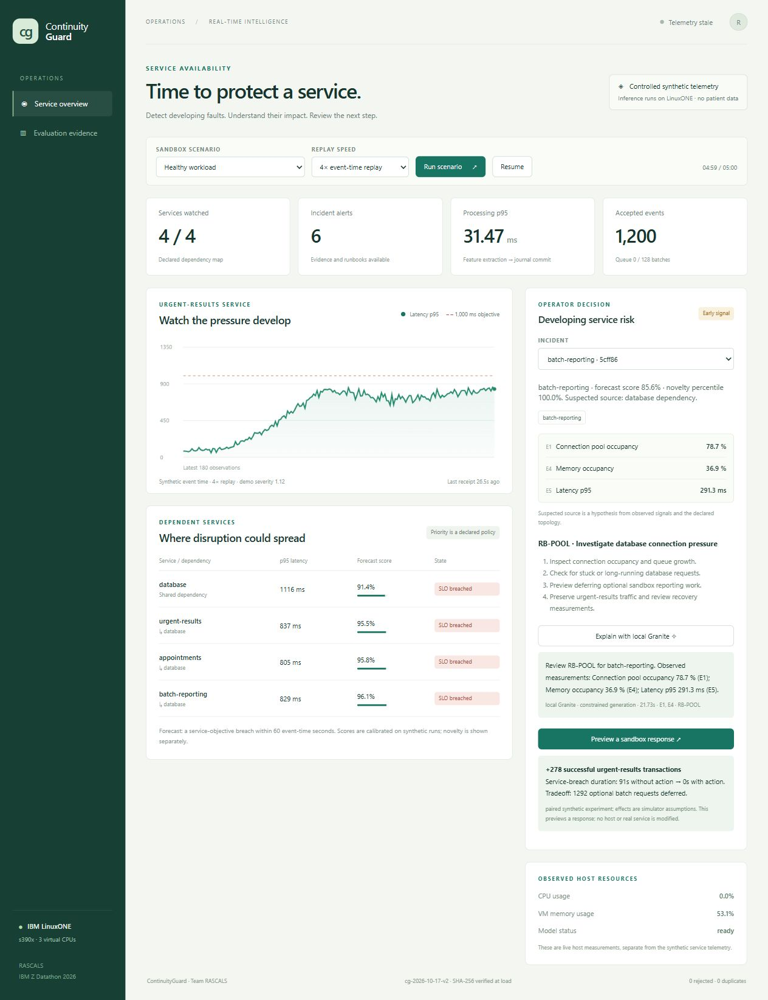
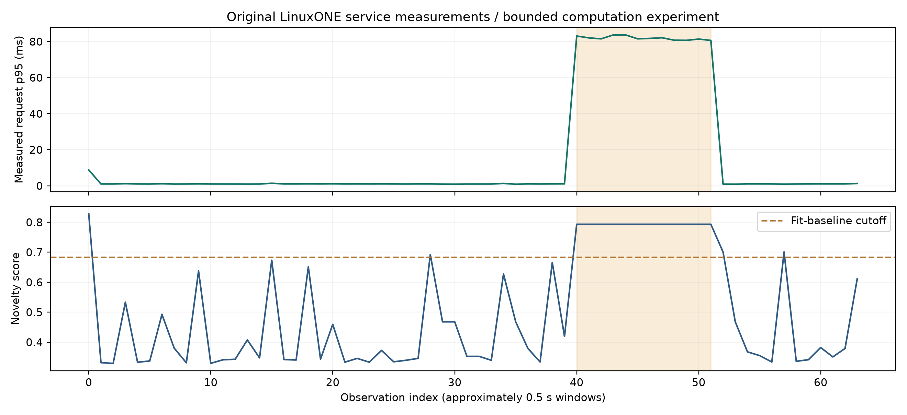
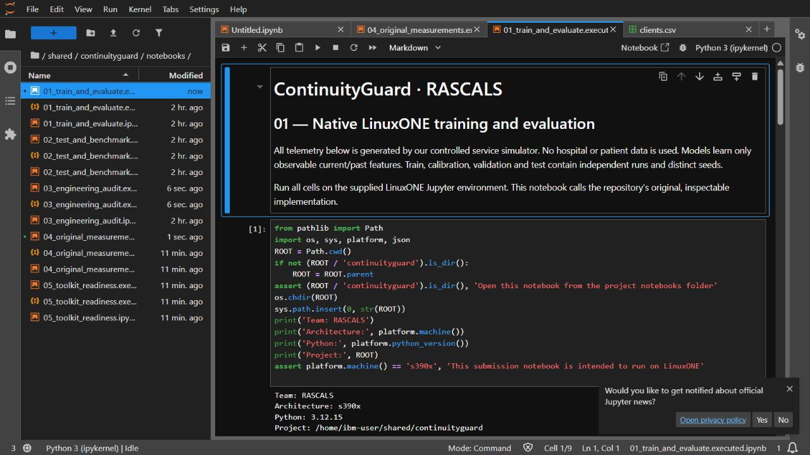
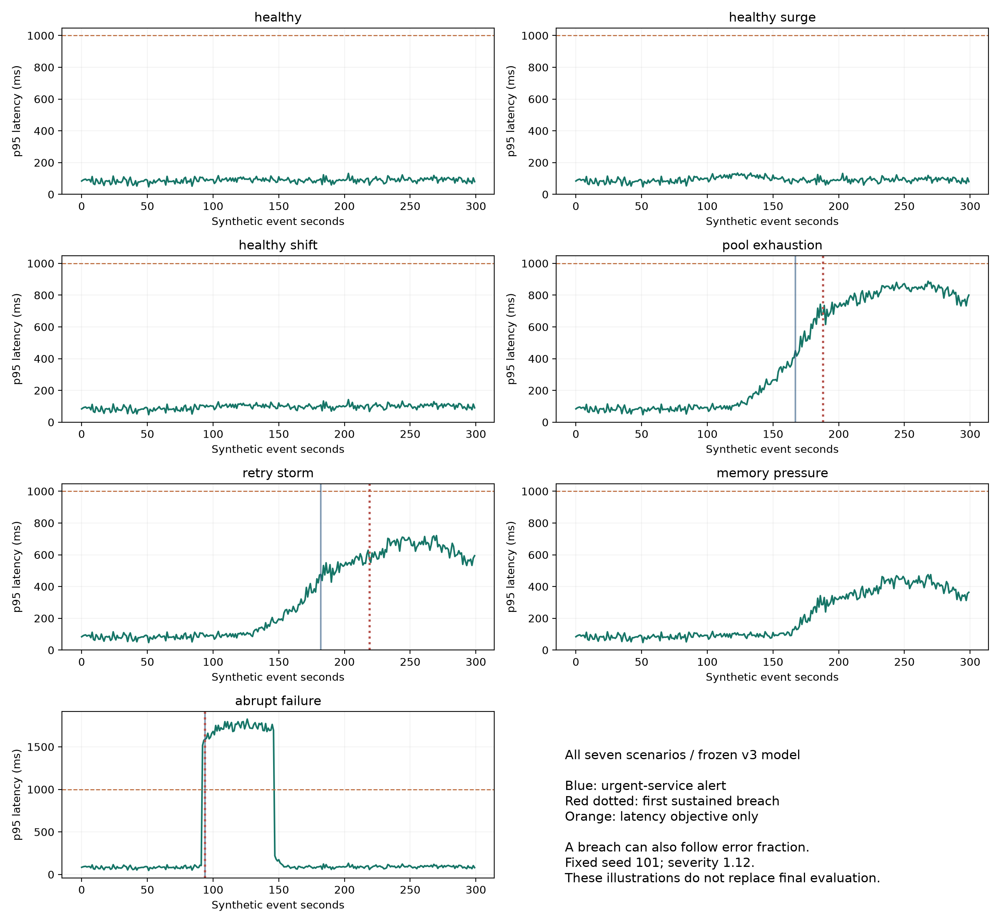

# RASCALS_IBM Z Datathon 2026 Project

## ContinuityGuard

**Theme:** Real-Time AI for Critical Decisions / System Anomaly Detection.

**Team:** ANBU SELVAN T; SAHANA G; DHARSHINI E; POOJA V. **Institution:** Hindustan Institute of Technology and Science.

Detect developing system faults from incoming telemetry, inspect an evidence-linked alert, and preview an operator response. Actual model training, testing, inference and constrained Granite generation run natively on IBM LinuxONE Community Cloud. The hospital-service scenario explains the beneficiaries; it is not clinical decision-making.

**Scope:** an operational research prototype with controlled synthetic telemetry. It is not production hospital validation and has not prevented a measured real outage. There is no guarantee of full marks, universal detection or superiority over every baseline.

## Start with the complete guide and outputs

- [Complete problem, solution, model and implementation summary](SUMMARY.md)
- [Output gallery and scenario results](docs/OUTPUTS.md)
- [Public-IP Jupyter/dashboard access and certificate check](docs/PUBLIC-ACCESS.md)
- [IBM Toolkit: applied guidance, ONNX preparation and entitlement boundary](docs/IBM-TOOLKIT.md)
- [Datathon learnings](SUMMARY.md#14-learnings-during-the-datathon)

The main evaluation uses declared **synthetic** scenarios. A separate native notebook now retains **original measured service data**, raw timestamps/counters and its provenance hash. These evidence classes are not interchangeable.

[Short submission walkthrough](submission/RASCALS-ContinuityGuard-Walkthrough.mp4) / [extended setup guide](submission/RASCALS-Implementation-Guide.mp4), Full HD with labeled synthetic narration.

## Review the submission

- [Pitch PDF](submission/RASCALS-ContinuityGuard-Pitch.pdf), [narrated evidence walkthrough](submission/RASCALS-ContinuityGuard-Walkthrough.mp4), [form answers](submission/FORM-ANSWERS.md).
- [Rubric evidence map](docs/RUBRIC-EVIDENCE.md), [technical design](docs/TECHNICAL-DESIGN.md), [current results](docs/RESULTS.md), [judging questions](docs/JUDGE-QUESTIONS.md).
- [Native execution proof](evidence/jupyter-ai-proof.json), [container verification](evidence/linuxone-verification.json), [restart check](evidence/restart-check.json), [HTTP measurement](artifacts/http-benchmark.json).
- [Source/resource credits](docs/ATTRIBUTIONS.md), [mandatory lab evidence](docs/LABS.md), [remaining submission actions](submission/FINAL-CHECKLIST.md).

## Current measured result

On 60 fresh synthetic runs, both ContinuityGuard and static thresholds warned before 31/43 service incidents. Median early lead was 13 seconds versus 10. Precision was 59.3% versus 60.0%; missed incidents were 11 versus 10. This does not establish consistent ML superiority.

| Detector | Early recall | Precision | Median early lead | Late | Missed |
|---|---:|---:|---:|---:|---:|
| Static thresholds | 72.1% | 60.0% | 10 s | 2 | 10 |
| Robust statistics | 44.2% | 11.9% | 39 s | 0 | 24 |
| Isolation Forest | 58.1% | 17.7% | 41 s | 0 | 18 |
| ContinuityGuard | 72.1% | 59.3% | 13 s | 1 | 11 |

The current model is **boosted_trees_7_leaves**, with sigmoid calibration and a **guarded_forecast** policy at **0.97**. In v3, learned risk OR static thresholds can trigger persistence. Isolation Forest is a separate novelty signal; novelty is not an outage probability or an independent paging trigger. The 60-second forecast and early matching window agree.

37 native tests passed. Actual local authenticated HTTP ingestion processed 1000/1000 events at 100 offered events/s in a 10-second trial. Read [measurement boundaries and uncertainty](docs/RESULTS.md) before quoting latency. Model hash and environment are in [manifest](artifacts/manifest.json).



## Output previews

### Original service measurements collected on LinuxONE



The separate measured-data experiment recorded 64 observations. Median request p95 was **0.98 ms** in the baseline check and **81.64 ms** during deliberately increased computation. All 12 pressure windows exceeded the baseline novelty cutoff; two recovery windows also did. These are real measurements from a small computation service, separate from the main synthetic forecast evaluation. [Raw CSV](artifacts/measured/original-linuxone-service.csv) / [full report](artifacts/measured/report.json).

### Executed AI training in JupyterLab



The saved notebook shows the native **s390x** kernel, fitting code and retained outputs. [Executed training notebook](notebooks/01_train_and_evaluate.executed.ipynb) / [37-test native audit](artifacts/correctness-report.json).

### Seven scenario timelines



These are clearly labeled **synthetic illustrations** from the frozen v3 model. Blue marks show urgent-service alerts; red dotted marks show sustained breach onset. Sudden failure has no demonstrated early warning. [Scenario output table](artifacts/scenarios/outputs.json) / [complete output gallery](docs/OUTPUTS.md).

## Reproduce through LinuxONE Jupyter

Open `shared/continuityguard/notebooks` in the supplied native s390x environment:

1. `01_train_and_evaluate.ipynb`: fit, calibrate, select and evaluate.
2. `02_test_and_benchmark.ipynb`: correctness and direct-engine timing.
3. `03_engineering_audit.ipynb`: final suite, actual isolated HTTP integration and local predictive/generative proof.
4. `04_original_measurements.ipynb`: original measured service timings and a separate novelty fit.
5. `05_toolkit_readiness.ipynb`: Random Forest and checked ONNX export; no entitled Toolkit execution claim.

Each source notebook has a retained executed copy and success record. Rerunning frozen final seeds is reproduction, not a new independent test. The v1/v2 development reports remain in artifacts. See [methodology](docs/METHODOLOGY.md), [data card](docs/DATA-CARD.md) and [model card](docs/MODEL-CARD.md).

```bash
python scripts/execute_notebook.py notebooks/01_train_and_evaluate.ipynb
python scripts/execute_notebook.py notebooks/02_test_and_benchmark.ipynb
python scripts/execute_notebook.py notebooks/03_engineering_audit.ipynb
python scripts/validate_submission.py
```

## Open Jupyter and the dashboard

Assigned VM: **https://148.100.99.173:38888/lab** for Jupyter and **https://148.100.99.173:8443** for the dashboard. Verify the short-lived certificate fingerprint in [public access](docs/PUBLIC-ACCESS.md) manually, then enter the appropriate private token. Both run on IBM LinuxONE. SSH is also supported:

```powershell
ssh -i "C:\path\to\your-key.pem" -N -o ExitOnForwardFailure=yes -L 127.0.0.1:8080:127.0.0.1:8080 -L 127.0.0.1:38888:127.0.0.1:38889 linux1@YOUR_VM_IP
```

Open `http://127.0.0.1:8080` for the app, or `http://127.0.0.1:38888/lab` for Jupyter. Their tokens are different. On the VM, retrieve the app token with `sudo podman exec continuityguard cat /home/ibm-user/cg-state/.access-token`. Never publish a private key, token, state database or authenticated URL.

### Open your notebooks in Chrome

1. Open **https://148.100.99.173:38888/lab**. This is Jupyter on the IBM VM.
2. Inspect the certificate and verify the fingerprint in [PUBLIC-ACCESS.md](docs/PUBLIC-ACCESS.md) before making the browser trust decision.
3. Enter your **Jupyter token** in the **Password or token** box, then select **Log in**. The dashboard token is different. No new password is needed.
4. In the left file browser open **shared > continuityguard > notebooks**. Open `01_train_and_evaluate.executed.ipynb` to view existing training results. Files ending `.executed.ipynb` retain outputs; the corresponding source notebooks are available for reruns.

If you need to retrieve the existing Jupyter token, run this in your private SSH session on the VM:

```bash
sudo podman exec datathon-notebook /opt/venv/bin/jupyter server list
```

Copy only the value after `token=` into the login form. Keep that command's output private; do not paste it into GitHub or a recording.

Choose database connection pressure and 4x replay. Inspect an incident, request an explanation and preview the sandbox response. The selected policy includes a threshold guard: a warning can occur even when the displayed learned score is below 0.97. In Evaluation evidence, inspect the live platform controls and verify the audit journal.

External input is a separate session: stop/reset the sandbox using `POST /api/external-session` (or the External stream button), then send validated windows to `POST /api/events`. Client-supplied synthetic provenance is overwritten. Response previews are disabled for external input. [Adapter and schema](docs/EXTERNAL-INPUT.md) explain the limits; forecasts require validation on real deployment data.

## Deploy and inspect

```bash
python3 scripts/deploy_linuxone.py /absolute/project/path
# Deliberate update, preserving state and a stopped rollback container:
python3 scripts/deploy_linuxone.py /absolute/project/path --replace
python3 scripts/verify_linuxone.py /absolute/project/path --restart --demo
```

The host is RHEL 9.8, with Podman. The app is UID 1000, read-only root, capped CPU/memory/PIDs, capabilities dropped and no-new-privileges. Its backend binds loopback; SSH or an authenticated TLS proxy provides access. Host networking is an explicit tradeoff. [Deployment](docs/DEPLOYMENT.md) records the pinned-image compatibility path and restart behavior. Do not run a development server on occupied port 8080; use `CG_PORT=8081` for an independent instance.

## Repository organization

`continuityguard/` contains the simulator, features, models, runtime, API and interface. `notebooks/` holds native experiments and executed evidence. `tests/` exercises failure boundaries. `artifacts/` retains trained models and measured reports. `evidence/` contains redacted actual execution/deployment proof. `docs/` explains methods and limits. `submission/` holds team metadata, PDF/video and form materials. `scripts/` provides reproducible execution, deployment and packaging.

## Originality and assistance

The contribution is this specific integration of warning evidence, service priorities, constrained local generation and paired response preview. Established algorithms are credited; no world-first claim is made. Codex assisted architecture, coding, verification and preparation. The team must understand, review and disclose that assistance under organizer guidance. LinuxONE/s390x execution does not prove z/OS integration or AI accelerator use.
