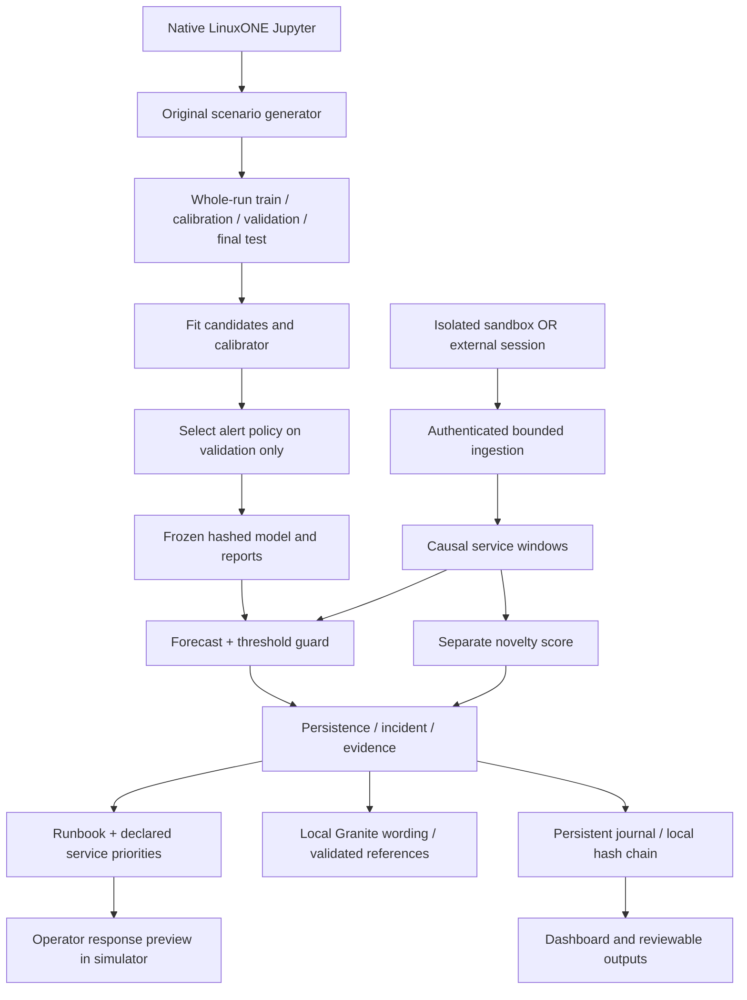

# RASCALS_IBM Z Datathon 2026 Project

## ContinuityGuard: complete explanation and implementation guide

**Team:** ANBU SELVAN T; SAHANA G; DHARSHINI E; POOJA V.

**Institution:** Hindustan Institute of Technology and Science.

**Theme:** Real-Time AI for Critical Decisions.

## 1. The problem statement

**System Anomaly Detection - how can AI identify abnormal system activity as it happens and alert organizations before it causes a major disruption?**

An IT operator may see latency, retries, resource consumption and failed requests on separate screens. A developing shared dependency fault can affect several services before an isolated threshold makes the next action clear. Our hospital-software setting makes the service priorities concrete: results access and appointment systems depend on a database; optional reporting can compete for capacity. These are software services, not clinical decisions.

The intended beneficiaries are IT operations teams and, indirectly, people relying on available digital services. We have not measured patient benefit or prevented a production outage. NHS incident context is cited in the pitch only to explain the consequences of infrastructure unavailability, not to claim that our model could have prevented that event.

## 2. The solution in one paragraph

ContinuityGuard continuously processes service-window telemetry on IBM LinuxONE. Causal features feed a calibrated learned forecast and an independent novelty estimator. A validation-selected threshold guard and persistence rules produce an incident. The incident retains measured evidence, declared downstream service priorities and a reviewed investigation runbook. Local Granite generates constrained explanatory wording with complete evidence references. An operator can compare an allowlisted simulator action against no action under identical future demand. The browser exposes what the system observed, why investigation was suggested and what the preview assumes.

## 3. What is original and what is measured

| Evidence class | Origin | Correct interpretation |
|---|---|---|
| Hospital-service scenarios | Original simulator written for this project | Controlled synthetic telemetry; not collected from a hospital |
| Final forecast results | Frozen v3 model evaluated on fresh synthetic runs | Performance within that simulator family |
| Original service CSV | Actual request timings/process counters collected on this LinuxONE VM | Real bounded localhost computation experiment; not a hospital failure |
| HTTP throughput | Actual authenticated API requests, queue, inference and SQLite path | Real local processing of synthetic fixture events |
| Platform proof | Actual s390x process/container properties | Native LinuxONE execution and stated controls |
| Action/no-action preview | Identical synthetic demand/noise branches | Simulator-conditional effects, not proven real prevention |

Nothing should be described as 100% accurate or guaranteed bug-free. Synthetic data is intentionally declared, not passed off as measured data. The real CSV contains timestamps, request timings, process counters and phase annotations, with a SHA-256 provenance check. No patient records, secrets or copied hospital data are used.

## 4. Where IBM LinuxONE and Jupyter are used

The assigned VM is `148.100.99.173`, native **s390x**, RHEL 9.8. Training kernels, models, experiments, inference, local generation, web API and journal run there. The laptop edits files and displays the browser. Opening localhost through SSH still accesses the IBM VM; the localhost address is the client-side tunnel endpoint.

Public TLS access is also configured:

- JupyterLab: **https://148.100.99.173:8888/lab**
- Dashboard: **https://148.100.99.173:8443**

Read [certificate verification and access details](docs/PUBLIC-ACCESS.md) before entering credentials. The short-lived certificate is self-signed. Tokens are private and different for Jupyter and the app. Neither belongs in the repository or a recorded URL.

## 5. The workflow

The application does not execute commands against real services. The operator sees an investigation path and a clearly labeled controlled preview.

## 6. Data and features

The main simulator creates one aggregate event per service per synthetic second for four declared services. Inputs include request/failure counts, latency p95, pool occupancy, queue depth, retry fraction, CPU and memory fractions. Fault metadata and future values remain evaluator-only.

The 26 predictor inputs comprise eight current measurements, two load-normalized ratios, six rolling slopes, six rolling means and four service indicators. Features use only current/past observations. Fifteen observations warm the predictor. Older events are rejected; a gap over five event-time seconds resets the affected service's feature and persistence state. Training and online feature code are shared.

## 7. Which models are used, and why

| Component | Actual implementation | Reason and limit |
|---|---|---|
| Future breach model | scikit-learn HistGradientBoostingClassifier, 120 iterations, max 7 leaves, learning rate .06, L2=1 | Small nonlinear tabular model; won the declared validation objective among three candidates; not universally best |
| Score calibration | Separate sigmoid/logistic calibrator | Fits calibration runs, not final test; remaining overconfidence is published |
| Novelty | Isolation Forest, 100 trees, max_samples=256 | Learns healthy variation; novelty percentile is not outage probability |
| Current page policy | Forecast >=.97 OR fixed operational thresholds, then persistence | Selected on validation; a warning can occur below .97 because the guard is explicit |
| Local explanation | IBM Granite 4.0 H 350M base through supplied llama.cpp | Selects verified wording under strict schema; not free-form root-cause reasoning |
| Original measured-data experiment | Separate Isolation Forest fitted on 30 observed baseline windows | Demonstrates novelty on actual service timings; does not validate the breach forecast |
| Optional Toolkit challenger | 40-tree Random Forest, max depth 7, ONNX export checked | Validation-only preparation for a supported Snap ML model family; not deployed or accelerated |

The base model is supplied by the lab runtime and is not trained from scratch by the team. Our predictive estimator, calibrator and novelty references are fitted in native Jupyter. The provided Granite weights are not redistributed.

## 8. Training, evaluation and what changed during the audit

The main experiment uses 60 training runs, 18 calibration runs, 24 validation runs and 60 fresh final runs. Whole runs and distinct seeds remain separate. The current final seeds are 70000-series. Six additional abrupt-failure stress runs use 80000-series seeds.

An early development evaluation allowed alerts up to 90 seconds before incident onset although the model predicted 60 seconds ahead. The audit aligned the early matching window to 60 seconds, repeated policy selection on validation and used a new final seed range. Earlier reports are retained as development history rather than hidden. Rerunning the frozen final seeds is reproduction, not a new independent test.

Final v3 result: **31/43 service incidents warned before onset**, the same early count as static thresholds. Median lead among early detections is **13 seconds vs 10 seconds**. Incident precision is **59.3% vs 60.0%**; missed incidents are **11 vs 10**. This does not establish consistent ML superiority. Service incidents within one run are correlated. Whole-run bootstrap intervals and all denominators are published.

The abrupt stress set detected 24/24 service incidents and warned before none. An unseen sudden fault without observable precursors cannot be promised an advance warning. The system therefore detects and reports as well as forecasts; it does not claim every disruption is predictable.

## 9. Scenarios and actual outputs

[Scenario gallery and output table](docs/OUTPUTS.md) cover healthy load, healthy surge, healthy shift, pool exhaustion, retry storm, memory pressure and abrupt failure. Fixed-seed illustrations are separate from final model evaluation. For seed 101, urgent-results warnings occur at 167s before a 188s sustained breach for pool pressure, and at 182s before a 219s breach for retry storm. The abrupt example warns at 94s, the same second as sustained breach; it is detection, not an early warning.

The real measured-service notebook records 64 observations: baseline fitting, baseline checking, actual increased request computation, then recovery. The median measured request p95 was about **0.98 ms** in baseline checking and **81.64 ms** under controlled computation. All 12 pressure observations exceeded the baseline-derived novelty cutoff; 0/10 baseline-check and 2/12 recovery observations did. This small, controlled result is not production anomaly-detection accuracy.

## 10. The distinctive feature: an incident the operator can inspect

The contribution is the connection between a warning and a decision, rather than an unqualified high anomaly score. An incident retains observations, dependency context and a runbook. Local wording cites the same evidence IDs. A paired response preview preserves the same exogenous future demand/noise and shows both successful urgent-service work and deferred optional work. No claim is made that this integration is world-first.

The supplied demo proof includes an actual local explanation, a simulator preview and an intact journal. The preview's gains follow encoded intervention assumptions. An operator must validate the response against a real deployment before adopting it.

## 11. Implementation from scratch to end

1. Confirm registration, allowed build window, eligibility and the exact two mandatory lab assignments with organizers.
2. Create the LinuxONE VM and private SSH key. Use the actual OS instructions; this VM is RHEL, not Ubuntu.
3. Start the organizer-provided native Jupyter image with persistent lab storage. Complete both assigned lab workflows before project implementation; existing Churn/Loan execution evidence is retained, with organizer mapping still unconfirmed.
4. Clone the public project or copy the repository to Jupyter's `shared/continuityguard` directory. Never copy the private key into the project.
5. Run notebook 01 for main training, calibration, selection and evaluation. Inspect the model hash and complete report.
6. Run notebook 02 for correctness/direct-engine timing and 03 for final engineering tests, actual HTTP integration and native Granite proof.
7. Run notebook 04 for the original measured-service experiment and 05 for Toolkit preparation. Their scope differs from the main forecast evaluation.
8. Build the app container on the LinuxONE host using the deployment script. Apply its CPU/memory/PID limits, non-root identity and read-only root. Preserve the state volume during deliberate updates.
9. Run the verification script to record actual model/container properties, restart persistence and a full sandbox decision example.
10. Open the dashboard through SSH or verified public TLS. Start a healthy or fault scenario; inspect the retained incident; request a local explanation and response preview.
11. For authorized real aggregated input, explicitly switch to an external session. Use the adapter and inspect processing/rejection counts. Do not mix it with simulation or infer validated real-world risk from a synthetic-trained model.
12. Review the pitch, video, resource credits and checklist. Upload an accessible <=3-minute YouTube/Vimeo video and submit the portal manually. The extended implementation video is supporting material, not the compulsory short video.

## 12. IBM AI Toolkit use

The Toolkit's deployment guidance informed container separation, non-root identity, read-only filesystem, privilege restrictions and TLS/authenticated access. A separate Random Forest challenger was fitted/exported in native Jupyter because IBM lists that model family for Snap ML import. The IBM registry login is not configured, so the supported Snap ML container and accelerator are not claimed as executed. [Toolkit status and next steps](docs/IBM-TOOLKIT.md) explain the boundary. There is no z/OS deployment or IBM certification claim.

## 13. Security, resilience and feasibility

The app runs as UID 1000 with a read-only root, 2 GiB memory, 1.5 CPU quota, bounded PIDs, dropped capabilities and no-new-privileges. Authentication, cross-origin mutation checks, actual request-byte bounds, finite schema validation and a bounded queue protect the prototype. The proxy uses TLS; SELinux stays enforcing. Host networking and rootful host container operation remain explicit limitations.

The real HTTP integration processed all 1,000 offered synthetic fixture events in a 10-second 100-events/s trial. Client and server share the VM. Queue acknowledgement, engine processing and final completion have separate boundaries; no browser/WAN latency or peak capacity is claimed. An active-client restart retained the audit prefix without a forced kill. This is persistence, not high availability.

Thirty-seven regression tests passed natively. They cover causality, online/offline parity, malformed inputs, temporal gaps, overload, consumer failure, model corruption, provenance, authentication, TLS session cookies and grounded fallback. No test suite proves the absence of every bug. Durable exactly-once delivery, multi-node operation, signed artifacts, audit anchoring and real-domain validation remain adoption work.

## 14. Learnings during the datathon

- Native s390x execution and supported packages must be verified, not inferred from a brand name or architecture label.
- The supplied VM used RHEL and Podman; Ubuntu-only setup commands were inappropriate here.
- Real-time timing needs explicit boundaries. Queue acceptance is not completed inference, and short throughput tests are not capacity guarantees.
- The prediction target, incident matching rule and pitch headline must agree. Correcting that agreement reduced the initial headline and made it defensible.
- A local generative model is useful only within a clear role. Constraining wording and validating complete references makes its output reviewable.
- Data provenance matters: simulator data, actual measured service behavior and production hospital telemetry are different evidence classes.
- A technically complete prototype can still have competitive baselines. Report misses, precision and uncertainty instead of maximizing a promotional number.

## 15. Where every part is documented

| Need | File |
|---|---|
| Readable problem/solution and setup | This summary and `README.md` |
| Full architecture and model rationale | `docs/TECHNICAL-DESIGN.md`, `docs/MODEL-CARD.md` |
| Training/evaluation rules | `docs/METHODOLOGY.md`, `artifacts/report.json` |
| Data provenance | `docs/DATA-CARD.md`, `artifacts/measured/` |
| All outputs and scenarios | `docs/OUTPUTS.md`, `artifacts/scenarios/` |
| Platform and Toolkit evidence | `evidence/`, `docs/IBM-TOOLKIT.md` |
| Access and deployment | `docs/PUBLIC-ACCESS.md`, `docs/DEPLOYMENT.md` |
| Submission requirements/questions | `docs/RUBRIC-EVIDENCE.md`, `docs/JUDGE-QUESTIONS.md` |
| Team/pitch/videos/form | `submission/` |

## 16. What remains a team responsibility

Confirm the exact mandatory-lab mapping, eligibility/attendance/abstract requirements and organizer treatment of AI assistance. Understand the code before presenting it. Verify the certificate manually before using public login. Review and upload the short video, check public links while signed out, and submit before the actual portal deadline. No first-place result, full marks, clinical outcome or production readiness is guaranteed.
