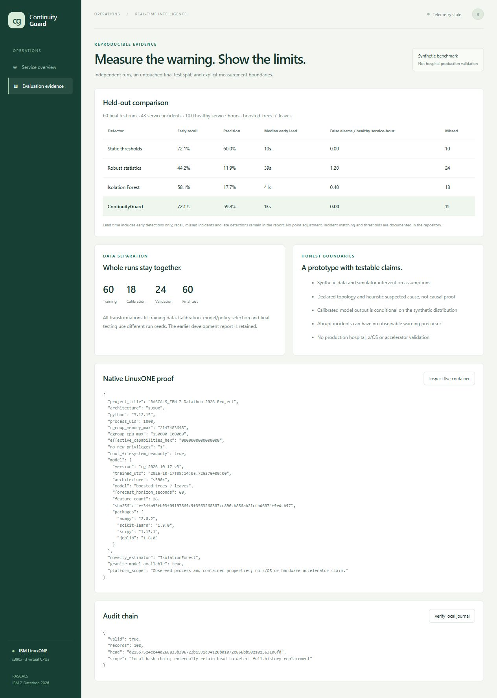
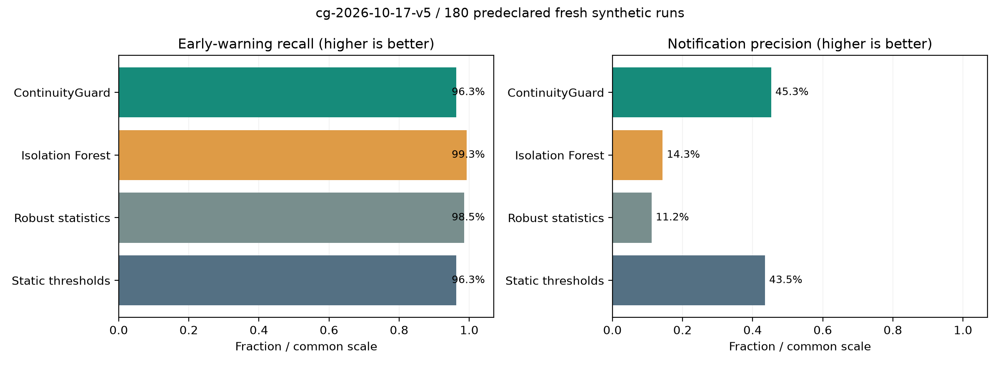

# Outputs: evidence you can inspect

## Actual application

The retained screenshot shows the actual V3 interface on controlled scenario data. Current V5 numerical and deployment evidence is linked below; it is not represented as a newly captured screenshot. Its retained evidence and local explanation are visible. The V5 policy preserves initial threshold warnings and uses learned risk for repeat triage.

This interface capture is historical. Current V5 values are in vidence/linuxone-verification.json and rtifacts/report.json.

## Seven fixed-seed scenarios

The table below is generated by the frozen model on seed 101, strength 1.12. It is an illustration, not an additional independent evaluation. `None` means no urgent-service sustained breach in that example. Other services may still alert.

| Scenario | All-service alerts | Urgent-service alert seconds | First urgent sustained breach |
|---|---:|---|---|
| healthy | 0 | [] | None |
| healthy_surge | 0 | [] | None |
| healthy_shift | 0 | [] | None |
| pool_exhaustion | 12 | [177, 237, 297] | 188 |
| retry_storm | 9 | [196, 226, 286] | 219 |
| memory_pressure | 1 | [] | None |
| abrupt_failure | 4 | [94] | 94 |

Blue vertical marks identify urgent-service alerts; red dotted marks identify first sustained breach. The orange line is the latency objective only: error fraction can also cause a breach. [Vector gallery](../artifacts/scenarios/scenario-gallery.svg), [raw scenario output](../artifacts/scenarios/outputs.json).

## Original measured service experiment

These are real observed request timings/process counters from a bounded localhost microservice, with actual increased hash computation in the annotated pressure phase. [Raw original CSV](../artifacts/measured/original-linuxone-service.csv), [report and hash](../artifacts/measured/report.json), [executed notebook](../notebooks/04_original_measurements.executed.ipynb).

It is a small separate novelty experiment, not hospital data or validation of the 60-second breach predictor. The recovery false alerts and limited baseline size are retained.

## Main model evaluation

Read [current results](RESULTS.md) with precision, misses, lead-time denominator, matching rule and bootstrap uncertainty. [Machine-readable final report](../artifacts/report.json) contains all incident details; v1/v2 reports remain labeled development history.

## Evidence index

| Output | Inspect |
|---|---|
| Current actual training and selected model | `notebooks/06_detector_upgrade.executed.ipynb`, `artifacts/manifest.json` |
| Frozen-model review | `notebooks/01_train_and_evaluate.executed.ipynb` |
| Correctness and engine timing | `notebooks/02_test_and_benchmark.executed.ipynb` |
| Native audit, actual HTTP and Granite | `notebooks/03_engineering_audit.executed.ipynb`, `evidence/jupyter-ai-proof.json` |
| Original measurements | `notebooks/04_original_measurements.executed.ipynb`, `artifacts/measured/` |
| IBM Toolkit preparation | `notebooks/05_toolkit_readiness.executed.ipynb`, `artifacts/toolkit/readiness.json` |
| Actual HTTP queue/inference/journal test | `artifacts/http-benchmark.json` |
| Live container properties | `evidence/linuxone-verification.json` |
| Actual explanation/paired response | `evidence/demo-verification.json` |
| Restart with active streaming client | `evidence/restart-check.json` |
| Public TLS/IP connectivity | `evidence/public-connectivity.json`, `docs/PUBLIC-ACCESS.md` |
| Frozen deployed source consistency | `evidence/deployed-source-hashes.json` |
| Short and extended walkthroughs | `submission/`, with duration manifests and labeled narration |

Screenshots are captured from the actual interface; plots derive from saved report/CSV outputs. No screenshot should be interpreted as proof of a production hospital deployment. Secrets and authenticated URLs are excluded.
