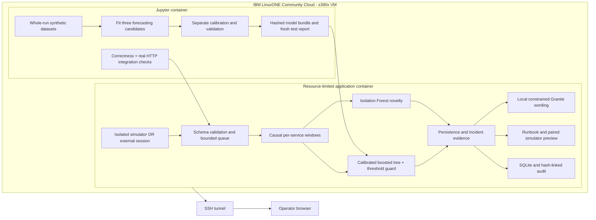

# Why this design answers System Anomaly Detection

The problem is operational: identify abnormal system activity as telemetry arrives and give an operator useful warning before a sustained service-objective breach. ContinuityGuard processes observed service windows continuously, rather than running a retrospective batch dashboard. Its hospital setting explains who benefits; it does not turn the model into a clinical decision system.

## Why LinuxONE is substantive

LinuxONE hosts the actual training kernels, stored model, real-time prediction, novelty scoring, local generation, web API and journal. The laptop is the editing/browser client; there is no remote model API receiving telemetry. Co-locating scoring and operational data is relevant to organizations whose critical workloads reside on IBM Z/LinuxONE: it avoids an extra external inference service in this prototype's decision path. This is an architectural rationale, not a measured comparison with an external cloud.

The organizer supplies a native s390x Python/Jupyter ML image. We use open-source scikit-learn, NumPy/SciPy and llama.cpp on that architecture and package the app with Podman. Observed process properties and model hashes are exposed through authenticated platform proof. The VM's RHEL host, container controls and resource limits are captured separately. No use of IBM Machine Learning for z/OS, z/OS transactions, Telum/Spyre acceleration, high availability, pervasive encryption or platform-wide performance superiority is inferred from merely using LinuxONE.

## Why Jupyter

Notebook 01 executes fitting, calibration, selection, final evaluation and plots through a native LinuxONE kernel. Notebook 02 runs tests and a direct-engine benchmark. Notebook 03 reruns the engineering suite, creates a separate real HTTP service for integration measurement, and verifies local predictive plus generative execution. Executed outputs, success records, model hashes and machine architecture remain available to judges. These are reproducible experiments, not screenshots of unexecuted code.

## Why these models and structures

- **Seven-leaf histogram gradient boosting:** handles nonlinear relationships among only 26 tabular inputs with small trees. It won the declared validation objective among logistic regression and two boosting candidates. It is not claimed universally best. A separate sigmoid calibrator reduces raw-score distortion but does not establish production probability accuracy.
- **Isolation Forest:** independent novelty reference trained on healthy workload variation. Its percentile is not an outage probability; it does not independently page in the selected policy.
- **Threshold guard:** the selected v3 policy ORs learned risk at its validated threshold with static operational limits. This protects obvious danger while preserving an explicit model-failure fallback. Predictive performance must be judged against the threshold baseline, including metrics that did not improve.
- **Bounded deques and OrderedDict:** causal rolling state and bounded recent event IDs. A telemetry gap resets warmup and persistence. This is bounded in-memory deduplication, not exactly-once replay across restarts.
- **Async bounded queue:** at most 128 batches of at most 128 schema-validated events; overload returns 429. Consumer failures are counted and make health degraded rather than silently killing processing.
- **SQLite WAL and streaming audit verification:** durable local records and hash-link checks. Event retention is 5,000 rows. Audit history persists and grows; retention/rotation of that history is an operational task. External anchoring is needed against whole-history replacement.
- **Local Granite:** bounded evidence wording, validated IDs and runbook. Generation is off the synchronous scoring path. It neither diagnoses a proven cause nor executes shell commands. A deterministic fallback is labeled.

## Boundaries that prevent misleading decisions

Forecast target and early incident matching both use 60 event-time seconds in v3. Every detector shares persistence, cooldown and matching rules. No retroactive point adjustment is used. Synthetic and external sessions are mutually exclusive; API callers cannot grant themselves synthetic provenance or enable a counterfactual preview for external data. Stale receipt age is visible. A finished replay cannot be resumed as if its producer still existed. Shutdown bounds long-lived streams and waits for explanation work before closing its journal.

The external adapter accepts already-aggregated service windows with known service identities; it is not a universal telemetry collector. Real deployment needs an authorized metrics exporter, stable one-second aggregation semantics, domain validation/calibration, operational response review and reliability testing. This prototype demonstrates the complete detection-to-decision path on the supplied VM within those stated boundaries.
